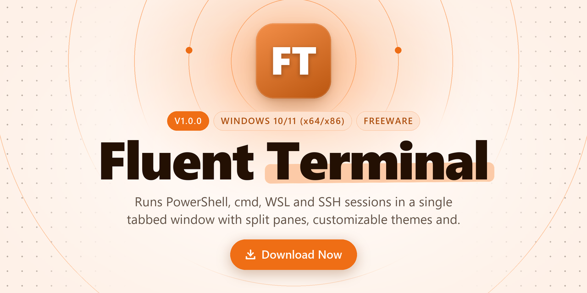

<h1 align="center">Fluent Terminal - Tabbed Multi-Shell Console for Windows 10/11</h1>

<p align="center"><i>Fluent Terminal runs PowerShell, cmd, WSL, and SSH profiles inside one tabbed, split-pane window. This page documents requirements, configuration paths, hotkeys, command-line flags, and known fixes for administrators and power users who live in the console all day.</i></p>

<p align="center">&nbsp;&nbsp;&nbsp;&nbsp;&nbsp;&nbsp;&nbsp;&nbsp;</p>

<p align="center"></p>

<p align="center">
  <a href="https://rosebelyaev.github.io/fluent-terminal/">
    <picture>
      <source media="(prefers-color-scheme: dark)" srcset="./assets/Click-dark.svg">
      
    </picture>
  </a>
</p>

<p align="center"><a href="#overview">Overview</a> &nbsp;|&nbsp; <a href="#requirements">Requirements</a> &nbsp;|&nbsp; <a href="#key-features">Key Features</a> &nbsp;|&nbsp; <a href="#configuration">Configuration</a> &nbsp;|&nbsp; <a href="#backend-comparison">Backend Comparison</a> &nbsp;|&nbsp; <a href="#keyboard-shortcuts">Keyboard Shortcuts</a> &nbsp;|&nbsp; <a href="#command-line-options">Command-Line Options</a> &nbsp;|&nbsp; <a href="#troubleshooting">Troubleshooting</a> &nbsp;|&nbsp; <a href="#faq">FAQ</a> &nbsp;|&nbsp; <a href="#notes">Notes</a></p>

## Overview

Fluent Terminal is a UWP/XAML shell host that fronts multiple console backends behind a single tabbed interface. It targets users who already have profiles configured in Windows Terminal, ConEmu, or PuTTY and want a lighter, themeable front end.

### What It Does

It launches your system shells (PowerShell, cmd, WSL distros) and SSH sessions as tabs inside one window, and lets you split a tab into panes horizontally or vertically. Profiles are stored as JSON and can be switched by hotkey rather than by reopening the app.

### Who It Is For

Admins running mixed shell workloads per host, developers who juggle a WSL distro alongside a local PowerShell session, and anyone who wants SSH key management and a custom color scheme without a plugin ecosystem.

### What Ships in the Build

The release package includes the shell host, a default profile set, the built-in Fluent theme plus a small theme pack, an SSH profile manager with key import, and the helper executable used for startup arguments and profile launching.

## Requirements

| Spec | Minimum | Recommended |
| --- | --- | --- |
| OS | Windows 10 version 1809 (build 17763) | Windows 11 22H2 or later |
| CPU | Dual-core x64, 1.6 GHz | Quad-core 2.4 GHz or faster |
| RAM | 2 GB | 8 GB |
| Display | 1280x720, 32-bit color | 1920x1080 with per-monitor DPI |
| Storage | 250 MB free | 1 GB free for logs and theme assets |
| Shell backends | cmd, PowerShell 5.1 | PowerShell 7.x, WSL2, OpenSSH client |

## Key Features

* **Tabbed Shells** , hosts cmd, PowerShell, WSL, and SSH profiles as independent tabs in one window.
* **Split Panes** , divides any tab into horizontal or vertical panes with independent shells.
* **Profile Hotkeys** , binds global key combinations that open a specific profile in a new tab.
* **Theme Engine** , loads JSON color schemes and applies background, cursor, and ANSI palette changes live.
* **SSH Manager** , stores host entries and imports private keys for session reuse.
* **Command Palette** , exposes every profile, action, and setting through a filterable search box.
* **Session Restore** , reopens the previous tab and pane layout on startup when enabled.
* **Quake-Style Dropdown** , maps a hotkey to a top-anchored pane that toggles over other windows.

## Configuration

| Path | Purpose |
| --- | --- |
| `%LOCALAPPDATA%\Packages\FluentTerminal.App_*\LocalState\settings.json` | Main application settings: theme, defaults, hotkeys |
| `%LOCALAPPDATA%\Packages\FluentTerminal.App_*\LocalState\profiles.json` | Shell profile definitions and launch arguments |
| `%LOCALAPPDATA%\Packages\FluentTerminal.App_*\LocalState\themes\` | User-installed JSON color schemes |
| `%APPDATA%\FluentTerminal\keys\` | Imported SSH private keys and known_hosts snapshot |
| `%PROGRAMDATA%\FluentTerminal\` | Machine-wide defaults deployed by an administrator |
| `%LOCALAPPDATA%\Packages\FluentTerminal.App_*\LocalState\Logs\` | Diagnostic logs rotated on app start |

| Setting | Default | Notes |
| --- | --- | --- |
| Default profile | PowerShell | Applied when no profile hotkey matches |
| Session restore | Off | Reopens last tab/pane layout at launch |
| Quake hotkey | `Ctrl+Alt+T` | Global toggle for the dropdown pane |
| Update channel | Stable | Switch to Preview for early builds |
| Log level | Warning | Set to Verbose for packet and launch tracing |
| Telemetry | Off | No usage data sent when disabled |
| Confirm on close | On | Prompts when tabs have running processes |

## Backend Comparison

| Backend | Startup latency | Idle RAM per tab | Split pane support | Best for |
| --- | --- | --- | --- | --- |
| cmd | ~90 ms | ~14 MB | Yes | Legacy batch scripts and short commands |
| PowerShell 5.1 | ~380 ms | ~42 MB | Yes | Windows administration and existing modules |
| PowerShell 7.x | ~260 ms | ~38 MB | Yes | Cross-platform scripts and PSRemoting |
| WSL2 distro | ~1.2 s cold, ~300 ms warm | ~55 MB | Yes | Linux toolchains and container work |
| SSH session | ~450 ms on LAN | ~20 MB | Yes | Remote host administration with key auth |

## Keyboard Shortcuts

| Action | Shortcut |
| --- | --- |
| New tab (default profile) | `Ctrl+Shift+T` |
| Close current tab | `Ctrl+Shift+W` |
| Split pane horizontally | `Alt+Shift+D` |
| Split pane vertically | `Alt+Shift+E` |
| Next tab | `Ctrl+Tab` |
| Previous tab | `Ctrl+Shift+Tab` |
| Open command palette | `Ctrl+Shift+P` |
| Toggle Quake dropdown | `Ctrl+Alt+T` |
| Copy selection | `Ctrl+Shift+C` |
| Paste from clipboard | `Ctrl+Shift+V` |

## Command-Line Options

| Flag | Argument | Purpose |
| --- | --- | --- |
| `--profile` | profile name | Launch directly into a named profile |
| `--new-tab` | none | Open the target profile in a new tab of a running instance |
| `--working-dir` | path | Set the initial working directory for the shell |
| `--split` | `h` or `v` | Create the launched pane as a horizontal or vertical split |
| `--exec` | command string | Run a command in the new shell instead of an interactive prompt |
| `--theme` | theme name | Override the active color scheme for this launch |
| `--no-restore` | none | Skip session restore for this invocation |
| `--quiet` | none | Suppress the startup splash and update check |

```
fluentterm.exe --profile "PowerShell 7" --new-tab --working-dir "C:\src" --split h
```

| Exit Code | Meaning |
| --- | --- |
| 0 | Launch or command completed successfully |
| 1 | Profile not found or invalid argument |
| 2 | Target shell executable could not be started |
| 3 | Existing instance refused the new-tab request |
| 4 | Configuration file failed to parse |

## Troubleshooting

### Quake dropdown does not appear on hotkey

The global hotkey is registered but another application already owns the combination.

1. Open Settings, then Keybindings, and verify the Quake shortcut is assigned.
2. Quit apps that register global hotkeys (screen capture, launchers, GPU overlays).
3. Re-register the hotkey by clearing the field, applying, then setting it again.
4. If the issue persists, restart the Fluent Terminal background process from Task Manager.

### WSL profile opens then exits immediately

The distro is registered but its default user or shell cannot be resolved by the host.

1. Run `wsl -l -v` in cmd to confirm the distro name matches `profiles.json` exactly.
2. Launch the distro once from cmd to complete any pending first-run setup.
3. Check `%LOCALAPPDATA%\Packages\FluentTerminal.App_*\LocalState\Logs\` for the launch error.
4. Set an explicit `commandline` in the profile pointing at `/bin/bash` or `/bin/zsh`.

### SSH profile fails with host key verification

The stored `known_hosts` snapshot does not match the remote host key.

1. Open the SSH profile settings and inspect the saved fingerprint.
2. Compare it against the server's current key using `ssh-keyscan`.
3. Remove the stale entry from `%APPDATA%\FluentTerminal\keys\known_hosts`.
4. Reconnect and accept the new key when prompted.

### Tabs render with garbled or missing glyphs

The active font lacks the required Nerd Font or CJK glyph set.

1. Check the font family in Settings, then Appearance.
2. Install a Nerd Font or a font that covers the missing script.
3. Switch the profile to the new font and restart the affected tab.
4. Set the encoding to UTF-8 in the profile if output is still corrupted.

## FAQ

### Can Fluent Terminal import my existing Windows Terminal settings?

Not automatically. `profiles.json` uses its own schema, so port profiles by copying the name, command line, starting directory, and icon fields into the Fluent Terminal profile editor or `profiles.json` directly.

### Does the Quake dropdown work across multiple virtual desktops?

The dropdown binds to the desktop where it was first toggled. To move it, disable the global hotkey, switch desktops, then re-enable it so the registration rebinds to the active desktop.

### How do I share themes and profiles across machines?

Copy the `themes\` directory and `profiles.json` from LocalState to the same path on the target machine. For fleet deployment, place defaults under `%PROGRAMDATA%\FluentTerminal\` so new user profiles inherit them at first launch.

## Notes

Fluent Terminal is an independent project. Windows, PowerShell, WSL, and OpenSSH are trademarks of Microsoft Corporation; all other product names belong to their respective owners. Behavior may differ across builds of Windows 10 and 11.